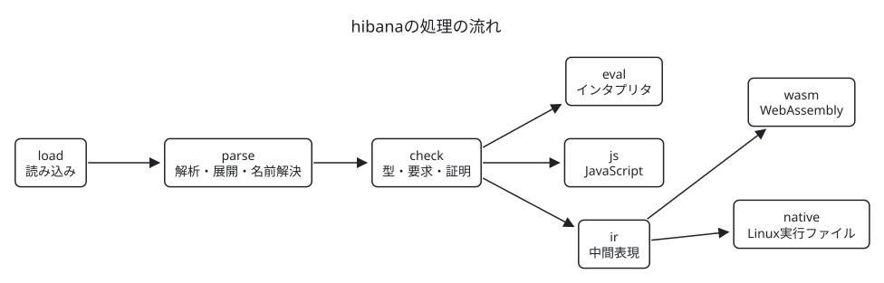

# hibana は何を検査し、どう実行するか

hibana は Rust で実装した静的型付けのプログラミング言語です。静的型付けとは、実行する前に値と操作の型を検査する仕組みです。細分化型、`with` による要求と提供、トレイト、マクロを持ち、インタプリタ・JavaScript・WebAssembly・ネイティブの4方式で実行できます。

想定読者は、プログラミングの経験があり、このリポジトリの構成を把握したい開発者です。この読者像は依頼からの仮定です。構文の学習には[入門](tutorial.md)、規則の確認には[言語仕様](spec.md)を使い、この資料では言語の特徴、処理の流れ、実装を読む入口を扱います。

| 確認したいこと | 概要 | 参照先 |
|---|---|---|
| 何を検査するか | 型、値が満たす条件、配列の添字、関数が要求する処理 | [検査の実装](../src/check/typeck.rs) |
| どう実行するか | 構文木の評価、JavaScript生成、共通の中間表現を使ったWASM・ネイティブ生成 | [処理の各段階](../src/pipeline.rs) |
| どう利用するか | コマンドで実行・整形・テスト、Rustの関数でコード生成 | [公開関数](../src/lib.rs)、[コマンド処理](../src/cli/mod.rs) |
| どう確かめるか | 言語機能の検査、実行方式間の出力比較、例と整形の確認 | [テスト](../tests/)、[統合テスト](../src/cli/mod.rs) |

## 言語の特徴

`number` は有限な64ビット浮動小数点数、`int` はそのうち ±(2^53 − 1) の範囲の整数です。整数演算は範囲外の結果で停止し、`number` を含む演算は浮動小数点数として計算します。JavaScript と WASM の公開関数・外部関数では両方を JavaScript の `number` で受け渡します。

**細分化型**は、条件を満たす値だけを許す型です。たとえば `int[x -> x > 0]` は正の整数を表します。配列の添字には `0 <= i && i < len(v)` の証明が必要で、分岐やループの条件も証明に使います。整数の条件を定数計算や既知の事実で示せなければ、Z3（論理式を解く証明用のソフトウェア）へ問い合わせます。`number` の条件は Z3 の整数式にせず、非負性、区間、浮動小数点数の間隔から検査します。

[細分化型の例](../tests/programs/types/refine.hb)は、正の整数の配列 `[3, 1, 4]` を作って合計します。次のコマンドで型検査と実行を確認できます。

```sh
nix develop -c cargo run -q -- tests/programs/types/refine.hb
```

<!-- output: refine -->
```text
[3, 1, 4]
8
```

**要求と提供**は、関数が必要とする処理を `with` で宣言し、呼び出し側が実装を渡す仕組みです。代数的効果とも呼び、失敗処理、ログ、依存する値の受け渡しを表します。提供した関数が値を返すと呼び出した位置から処理が続き、`exit` は対応する `with` ブロックを抜けます。非同期処理も組み込みの要求 `Async` で表します。

**トレイト**は、型が備えるメソッドを宣言する仕組みです。`trait` と `impl` で宣言・実装し、要求と提供にも使います。型引数によるジェネリクス（複数の型に共通する定義）と、要求の多相（渡された関数の要求を受け継ぐ定義）に対応します。

**マクロ**は、コードを生成する仕組みです。`syntax` で文法、`macro` で展開を宣言します。展開の中で束縛する名前を付け替え、呼び出し元の変数を捕まえないようにします。この性質を衛生性と呼びます。

## ソースから実行まで

次の図は、[公開関数](../src/lib.rs)と[処理の各段階](../src/pipeline.rs)で確認した受け渡しを描いたものです。矢印は処理の進行を表し、ファイル間の依存関係は表しません。



`load` は組み込みライブラリ、名前で指定したhibanaファイル、JavaScript・TypeScriptの型宣言を読み込みます。`use util` は `util.hb`、`use foo::bar` は `foo/bar.hb` を読み込み元のファイルのディレクトリから探します。`parse` は字句・構文解析を行い、マクロ展開と名前解決を終えた構文木（ソースの構造を表すデータ）を作ります。[構文解析器](../src/frontend/parser.rs)がこれらの処理をまとめています。

`check` は型、トレイト、要求、細分化型の条件を検査し、省略された引数を補完します。実行用では `main` を要求し、ライブラリ用では要求しません。証明はこの段階で行い、実行時の証明処理としては残しません。

`eval` は型検査後の構文木を評価し、`js` は同じ構文木と型検査の情報からJavaScriptを生成します。`ir` は型検査後の構文木をIR（コード生成用の中間表現）へ変換します。

`wasm` と `native` は共通のIRを使います。`wasm` はWebAssembly（実行環境に読み込ませるバイナリー形式）、`native` はCranelift（機械語の生成器）でLinuxの実行ファイルを作ります。この図には整形、エラー表示、WASMとJavaScript間の接続コード、マクロ内部の評価器の利用を含めていません。

## 利用できる入口と対応範囲

コマンドラインから使える操作は次の3つです。`fmt` はファイルを書き戻し、`test` はファイル内のテストをインタプリタで実行します。

| 操作 | コマンド |
|---|---|
| 実行 | `hibana <ファイル>` |
| 整形 | `hibana fmt <ファイル>` |
| テスト | `hibana test <ファイル...>` |

コード生成はRustのAPI（プログラムから呼び出す関数群）を使います。生成物のファイル保存と実行は呼び出し側が行います。

| 実行方式 | Rustの入口 | 対応範囲・制約 |
|---|---|---|
| インタプリタ | `hibana::run` | 型検査後の構文木を評価する。JavaScriptの外部関数は実行しない |
| JavaScript | `hibana::to_js` | JavaScript・TypeScriptとの連携や非同期処理に対応する |
| WebAssembly | `hibana::to_wasm`、`hibana::to_web` | `to_wasm` は `main` 用、`to_web` は指定した公開関数とJavaScript接続コードを生成する |
| ネイティブ | `hibana::to_native` | x86-64のLinux用。Cの標準ライブラリや外部リンカーに依存せず、外部関数は未対応 |

WASMの公開関数・外部関数の境界で渡せる型は `int`・`number`・`String`・`bool`・`unit` と、それらの `Vec` と構造体です。外部関数の接続は同期呼び出しに限ります。IRを使うWASMとネイティブは、シャドースタックを根にするマーク＆スイープのGC（使わなくなったメモリを自動で回収する仕組み）で、確保したメモリを回収します。`Task.wait()` はネイティブ向けで、JavaScriptとWASMでは拒否されます。詳細は[WASMの説明](wasm.md)と[言語仕様の既知の制約](spec.md#12-既知の制約)にあります。

## 実装を読む入口

| 場所 | 役割 |
|---|---|
| `src/lib.rs`、`src/main.rs` | ライブラリと実行コマンドの入口 |
| `src/pipeline.rs` | 読み込み、構文解析、検査、IR変換、公開関数の選択、WASM・JavaScript生成 |
| `src/frontend/` | 字句・構文解析、名前解決、モジュールの読み込み、マクロ、TypeScript宣言の読み込み |
| `src/check/` | 型検査、トレイト解決、要求の検査、細分化型の証明、Z3との接続 |
| `src/backend/` | 4つの実行方式と、WASM・ネイティブ共通のIR |
| `src/tooling/`、`src/cli/`、`src/error.rs` | 整形、コマンド処理、エラー情報と表示 |
| `lib/` | hibanaで書かれた標準ライブラリ |
| `examples/` | 利用者が書く、動作と書き方の基準となる例 |
| `tests/`、`tests/programs/` | Rust側のテストと、言語機能別の入力プログラム |

処理全体は `src/lib.rs` から `src/pipeline.rs`、構文は `src/frontend/parser.rs`、検査規則は `src/check/typeck.rs`、実行方式の差は `src/backend/` の順で辿れます。

## 開発と検証

Nixのflake（開発環境と依存関係を定義する仕組み）がRust、Z3、Node.jsを用意します。リポジトリのルートで実行します。

```sh
nix develop -c cargo build
nix develop -c cargo test
```

`cargo test` はコマンド確認用の `target/debug/hibana` を更新しないため、その実行ファイルを使う前に `cargo build` を行います。言語内のテストは `nix develop -c cargo run -q -- test tests/programs/stdlib/stdlib.hb` で実行できます。

[コマンド処理内のテスト](../src/cli/mod.rs)は、対応するプログラムのインタプリタ・JavaScript・WASM・ネイティブの出力を比較します。[tests/first.rs](../tests/first.rs)は標準入力を使う例を4方式で比較し、[tests/pipeline.rs](../tests/pipeline.rs)は変換・公開関数の選択・JavaScript接続を確認します。言語機能ごとの入力は[カテゴリ一覧](../tests/programs/README.md)から探せます。

開発時は `examples/` を動作の基準とし、利用者の指示なしに変更しません。標準ライブラリの関数追加には `tests/programs/stdlib/stdlib.hb` のテストを追加し、`.hb` ファイルは `hibana fmt` で整形します。

## 読み終えた後の確認

<details>
<summary>細分化型の条件は、実行時にZ3で検査するか？</summary>

コンパイル時に証明します。まず定数計算と既知の事実を使い、必要ならZ3へ問い合わせます。整数のオーバーフローなど、実行時に検査する条件も別にあります。

</details>

<details>
<summary>4つの実行方式は、すべて共通のIRを使うか？</summary>

WASMとネイティブが共通のIRを使います。インタプリタとJavaScript生成は型検査後の構文木を使います。

</details>

<details>
<summary>WASMを生成するには、どの入口を使うか？</summary>

Rustから `hibana::to_wasm` や `hibana::to_web` を呼びます。コマンドラインの操作は実行・整形・テストです。

</details>
